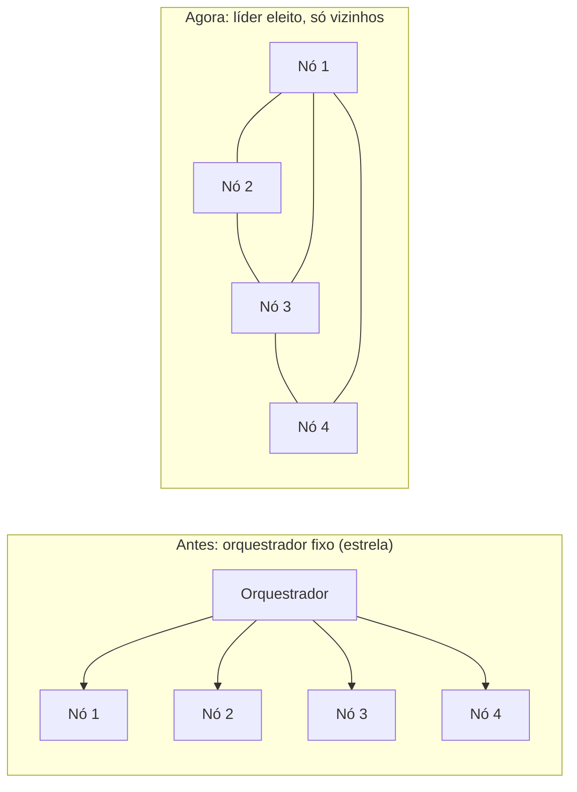
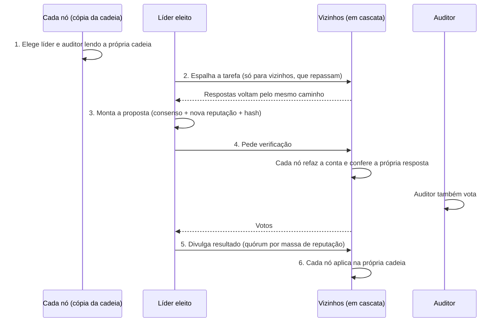
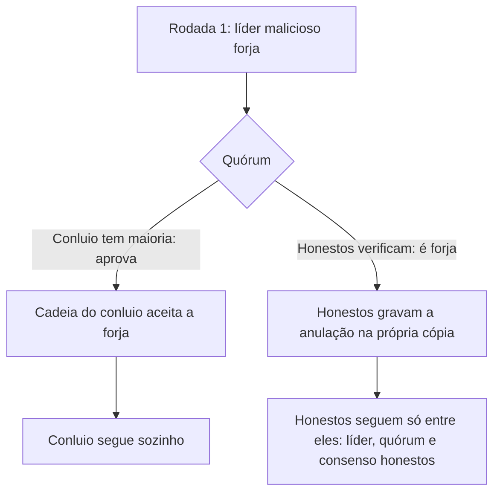
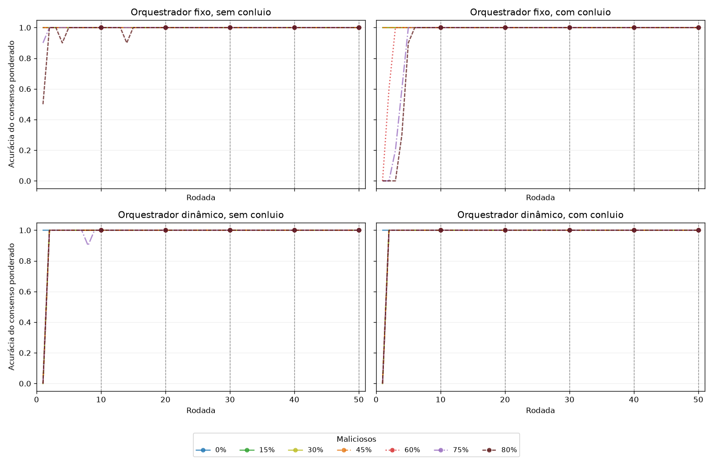
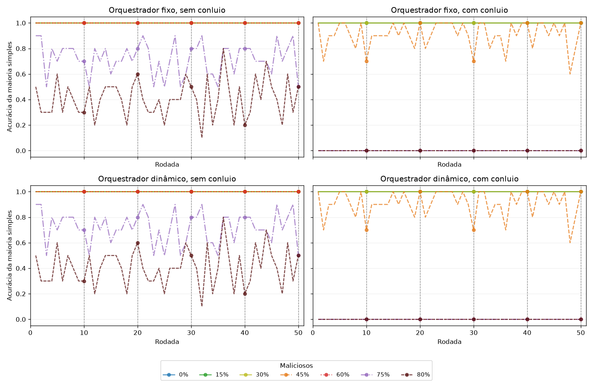
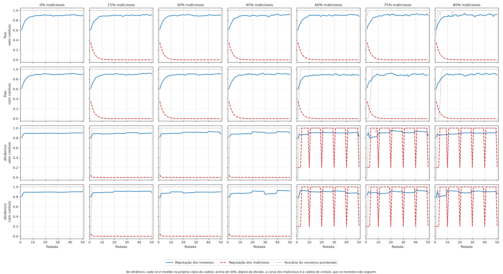
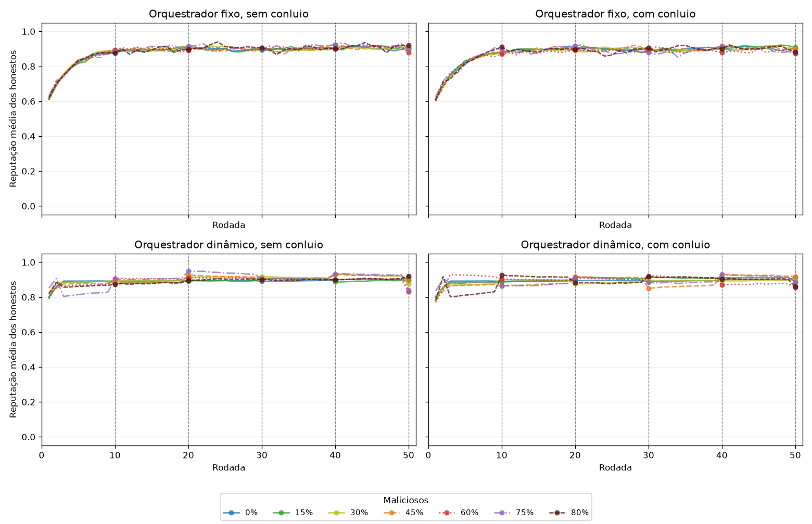
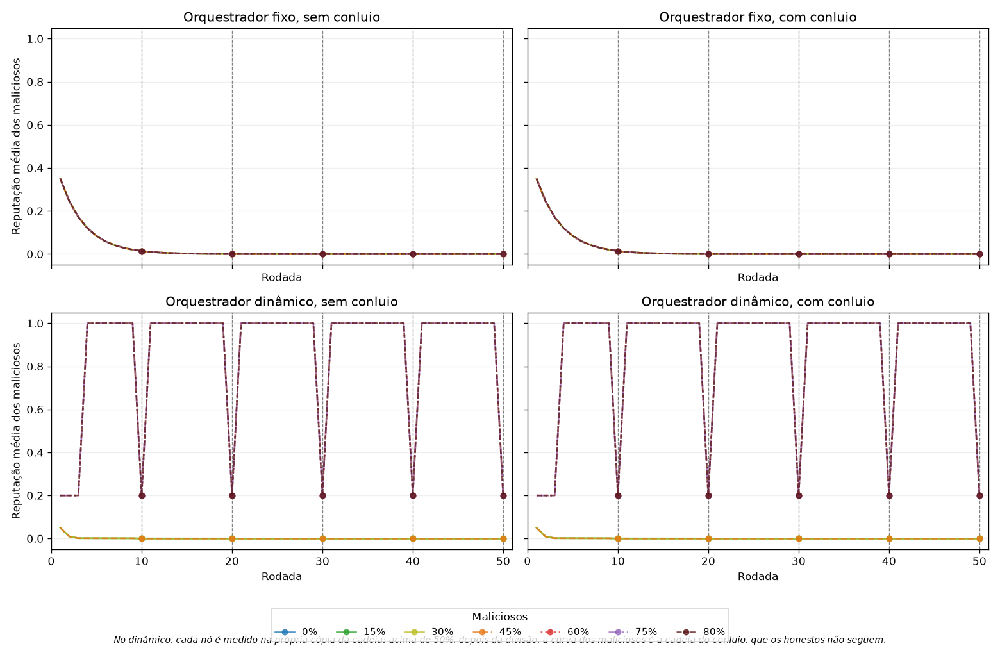

# Resumo para apresentação — Orquestrador dinâmico

**Alunos:** Allan Mateus Arruda de Souza e Lara Andrade Carvalho
**Orientadores:** Prof. Danilo Maia e Prof. Leonardo Vilela Cardoso
**Tema:** rede distribuída de inferência com reputação dinâmica — da versão com orquestrador fixo para uma rede em que o próprio líder é eleito entre os nós.

---

## 1. Em uma frase

Na primeira versão, um orquestrador central fixo distribuía as tarefas, calculava o consenso e mantinha a reputação de todos. Nesta etapa esse centro deixou de existir. A cada rodada a rede **elege um líder** entre os próprios nós, um **auditor** confere o trabalho dele, as decisões ficam numa **cadeia de registros encadeados por hash** que cada nó guarda e confere, e a rodada só vale se os nós que confirmam somam **mais da metade da reputação** dos participantes.

O objetivo foi responder a três perguntas:

1. A versão distribuída mantém o resultado do orquestrador fixo?
2. Um líder malicioso consegue manipular a reputação dos outros nós?
3. O que acontece quando os maliciosos estão em maioria e agem em conluio?

---


## 2. Do fixo ao dinâmico




| Aspecto                             | Orquestrador fixo               | Orquestrador dinâmico                                |
| ----------------------------------- | ------------------------------- | ---------------------------------------------------- |
| Quem conduz a rodada                | Sempre o mesmo processo central | Um nó eleito a cada rodada                           |
| Quem guarda a reputação             | O orquestrador                  | Cada nó, numa cópia da cadeia                        |
| Comunicação                         | Orquestrador fala com todos     | Cada nó fala só com os vizinhos do grafo             |
| Quem garante que a conta está certa | Confiança no orquestrador       | Cada nó refaz a conta e vota                         |
| Sinal da reputação                  | Gabarito em toda rodada         | Consenso na maioria das rodadas, gabarito em algumas |
| Ponto único de falha                | Sim                             | Não                                                  |


---


## 3. Peças que já existiam (base do sistema)


### 3.1 Nós e perfis

Cada nó resolve a mesma tarefa (problema do GSM8K) e devolve uma resposta numérica. Nas simulações o comportamento é dado pelo perfil:


| Perfil    | Comportamento                                                                                       |
| --------- | --------------------------------------------------------------------------------------------------- |
| Honesto   | Acerta com probabilidade 0,9; quando erra, dá um valor próximo do certo                             |
| Malicioso | Sem conluio, erra com um valor qualquer. **Em conluio**, todos respondem o mesmo valor errado (999) |
| Instável  | Fica sem responder em 30% das vezes; quando responde, acerta em 50%                                 |


### 3.2 Reputação (três mecanismos)

Todo nó começa com reputação 0,5. A cada rodada recebe um sinal `s = 1` (acertou) ou `s = 0` (errou ou não respondeu).


| Mecanismo       | Regra                                                                              |
| --------------- | ---------------------------------------------------------------------------------- |
| EMA             | `r ← (1 − α)·r + α·s`, com α = 0,3                                                 |
| EMA assimétrica | Igual à EMA, mas a descida usa α/2: o nó perde reputação mais devagar do que ganha |
| Beta            | Conta acertos `a` e erros `e` (começando em 1 e 1); a reputação é `a / (a + e)`    |


### 3.3 Consenso ponderado

Cada resposta recebe a soma das reputações dos nós que a deram. Vence a de maior soma. Em empate, vence o menor valor (regra fixa, para todos os nós chegarem ao mesmo resultado). A **maioria simples** (um voto por nó) é a linha de base de comparação.

### 3.4 Rodadas de teste

Em todos os experimentos há um teste a cada 10 rodadas: 10, 20, 30, 40 e 50. A acurácia de teste é medida só nessas rodadas, o que permite comparar experimentos diferentes no mesmo ponto.

---


## 4. Peças novas


### 4.1 Grafo entre os nós (quem conversa com quem)

Arquivo: `sistema/core/topology.py`.

- **Completo (**`star`**)**: todo nó é vizinho de todos. Não há um centro fixo, porque o "centro" agora é o líder da rodada.
- **4-regular (**`kregular`**)**: cada nó tem exatamente 4 vizinhos.
  - Começa como um anel: cada nó ligado aos 2 vizinhos de cada lado.
  - Depois as ligações são embaralhadas por trocas que mantêm os 4 vizinhos de cada nó e o grafo conexo.
  - O embaralhamento é determinado pela repetição. A mesma repetição gera o mesmo grafo na simulação e nos containers.

Com 20 nós no 4-regular, a maior distância entre dois nós é 4 saltos.

### 4.2 Cadeia de registros (o "livro-razão")

Arquivo: `sistema/core/ledger.py`.

Cada rodada vira um registro, e cada registro guarda o hash (SHA-256) do anterior. Alterar um registro antigo muda o hash dele e quebra o elo com o seguinte, então qualquer nó percebe.

Tipos de registro:


| Tipo      | Quando entra                                                            | O que contém                                                                                    |
| --------- | ----------------------------------------------------------------------- | ----------------------------------------------------------------------------------------------- |
| `round`   | A rodada foi aceita                                                     | Líder, auditor, respostas, consenso, estado de reputação depois da rodada e o hash desse estado |
| `void`    | A rodada foi anulada                                                    | Líder, motivo e quem foi punido                                                                 |
| `penalty` | A rodada foi aceita, mas alguém deve ser punido (veto falso do auditor) | Quem foi punido e por quê                                                                       |
| `oracle`  | Rodada de calibração ou de teste                                        | Gabarito e a resposta de cada nó                                                                |


O estado de cada nó (reputação, quem esteve presente, quem foi o último líder) **não é guardado à parte**. Ele é sempre recalculado lendo a cadeia do começo. Dois nós com a mesma cadeia têm exatamente o mesmo estado.

### 4.3 Dois scores por nó (quando a defesa "dois scores" está ligada)

- **Score de consenso**: peso da resposta do nó no consenso ponderado. Muda toda rodada.
- **Score de poder**: usado na eleição e no peso do voto do quórum. Só muda com o gabarito e com punições.

Sem essa defesa, os dois são o mesmo número.

---


## 5. Uma rodada, passo a passo




### Passo 1 — Eleição do líder

Arquivo: `sistema/core/election.py`. Cada nó calcula o líder sozinho, lendo a própria cadeia; como todos leem a mesma cadeia, todos chegam ao mesmo nome.


| Regra             | Como funciona                                                                                                                                                                        |
| ----------------- | ------------------------------------------------------------------------------------------------------------------------------------------------------------------------------------ |
| Disponibilidade   | Só concorre quem faltou no máximo 1 vez nas últimas 5 rodadas registradas na cadeia. A presença sai da cadeia, não de um aviso do próprio nó                                         |
| Largada           | Enquanto os scores ainda estão próximos (maior menos menor abaixo de 0,05), o papel gira em rodízio pela lista de nós                                                                |
| Depois da largada | Lidera o nó disponível de **maior score**, **sem repetir o líder da rodada anterior**                                                                                                |
| Score usado       | Na EMA, a própria reputação. No Beta, uma estimativa conservadora: `acertos / (acertos + erros + 2)`. Assim um nó com poucas rodadas não passa à frente de um nó com histórico longo |
| Empate            | Fica com o menor identificador                                                                                                                                                       |


### Passo 2 — Escolha do auditor

O auditor é o nó disponível de **maior score que esteja a pelo menos 2 saltos do líder** no grafo. A distância evita que o líder e o auditor sejam vizinhos diretos (mais fáceis de combinar). Se não houver ninguém a 2 saltos, vale o melhor disponível. No grafo completo, onde todos são vizinhos, o auditor é simplesmente o segundo melhor.

### Passo 3 — Difusão da tarefa

O líder manda a tarefa só aos seus vizinhos. Cada vizinho responde, repassa aos seus vizinhos e devolve as respostas que recebeu. Cada nó trata a mensagem **uma vez por rodada**. Um nó que segue outra cópia da cadeia (depois de uma divisão, item 7) **só repassa**: não responde, não vota e não grava.

### Passo 4 — Proposta do líder

O líder calcula:

1. o consenso ponderado das respostas;
2. a reputação de cada nó depois da rodada (quem concordou com o consenso sobe, quem discordou ou faltou desce);
3. o hash desse novo estado.

Tudo isso vai num registro ligado ao último registro da cadeia.

### Passo 5 — Verificação (o voto de cada nó)

Arquivo: `sistema/core/protocol.py`. Cada nó honesto confere, nesta ordem:


| Conferência                                                           | Se falhar, o voto é "não" com o motivo                |
| --------------------------------------------------------------------- | ----------------------------------------------------- |
| O registro aponta para o último registro da minha cadeia?             | `chain`                                               |
| O hash do registro bate com o conteúdo?                               | `hash`                                                |
| A **minha resposta** está no registro, sem alteração?                 | `censored` (o líder escondeu ou mudou minha resposta) |
| Refazendo a conta com as respostas listadas, chego ao mesmo consenso? | `false_consensus`                                     |
| Refazendo a conta, chego ao mesmo estado de reputação (mesmo hash)?   | `forged` (o líder adulterou as reputações)            |


As duas últimas conferências são **objetivas**: qualquer nó com a mesma cadeia chega ao mesmo resultado, mesmo sem ter visto as respostas originais.

### Passo 6 — Quórum e decisão

- A rodada é aceita se os nós que confirmaram somam **mais da metade da reputação de poder** de quem votou. Empate não passa.
- O voto vale o score de poder: um nó com reputação 0,9 pesa mais que um com 0,1.

Punições (cada punição é uma atualização de reputação com taxa 0,5 em direção a 0):


| Situação                                                        | Resultado                    | Quem é punido                                |
| --------------------------------------------------------------- | ---------------------------- | -------------------------------------------- |
| Proposta correta e aceita                                       | Registro `round`             | Ninguém                                      |
| Proposta com erro objetivo (forja ou consenso falso) e recusada | Registro `void`              | O líder e quem confirmou a proposta inválida |
| Censura denunciada e proposta recusada                          | Registro `void`              | O líder                                      |
| Recusada sem motivo verificável (só faltou quórum)              | Registro `void`              | Ninguém                                      |
| Aceita, mas o auditor vetou sem motivo verificável              | Registro `round` + `penalty` | O auditor (veto falso)                       |


Uma rodada anulada não gera consenso: ela conta como erro na acurácia daquela rodada.

### Passo 7 — Gabarito (sinal da reputação)


| Sinal                       | Quando a reputação usa o gabarito                           | Nas outras rodadas          |
| --------------------------- | ----------------------------------------------------------- | --------------------------- |
| `truth`                     | Toda rodada                                                 | —                           |
| `consensus`                 | Nunca                                                       | Concordância com o consenso |
| `hybrid` (usado nos testes) | Nas 3 primeiras rodadas (calibração) e nas rodadas de teste | Concordância com o consenso |


No híbrido, o gabarito entra em 8 das 50 rodadas. Ele vira um registro `oracle` na cadeia, que pode passar pelo mesmo quórum ou ser aplicado direto (defesa "gabarito fora do quórum").

---


## 6. Ataques simulados


| Ataque                             | Quem faz          | O que faz                                                                |
| ---------------------------------- | ----------------- | ------------------------------------------------------------------------ |
| Forja (`forge`)                    | Líder malicioso   | Põe reputação máxima nos comparsas e mínima nos honestos                 |
| Censura (`censor`)                 | Líder malicioso   | Tira as respostas dos honestos do registro, deixando só as dos comparsas |
| Consenso falso (`false_consensus`) | Líder malicioso   | Grava como consenso o valor do conluio                                   |
| Veto falso (`false_reject`)        | Auditor malicioso | Recusa propostas honestas alegando forja                                 |


Como os maliciosos votam:

- confirmam qualquer proposta de um líder comparsa;
- em propostas de líder honesto, votam como um honesto, para não se expor;
- votam contra a correção pelo gabarito quando ela passa pelo quórum.

---


## 7. Defesas contra conluio (cada uma pode ser ligada e desligada)

Arquivo: `sistema/core/defenses.py`.


| Defesa                      | Problema que ataca                                                    | Como funciona                                                                                                                                     |
| --------------------------- | --------------------------------------------------------------------- | ------------------------------------------------------------------------------------------------------------------------------------------------- |
| **Calibração**              | O conluio ganhar reputação no início, quando todos estão iguais       | Gabarito nas 3 primeiras rodadas, antes de o conluio se firmar                                                                                    |
| **Gabarito fora do quórum** | O conluio em maioria barrar a correção pelo gabarito                  | O registro do gabarito é aplicado direto, sem votação                                                                                             |
| **Taxas separadas**         | O consenso (que o conluio pode dominar) pesar tanto quanto o gabarito | Taxa 0,05 para o sinal de consenso e 0,8 para o gabarito                                                                                          |
| **Dois scores**             | O conluio ganhar poder de voto só concordando entre si                | O poder de voto (eleição e quórum) só muda com o gabarito                                                                                         |
| **Recusa (divisão)**        | O conluio em maioria aprovar uma forja pelo quórum                    | O honesto que vê uma forja aprovada **não aceita**. Grava a anulação na própria cópia, pune o líder e quem confirmou, e passa a seguir essa cópia |


Os experimentos testam:

- nenhuma defesa;
- cada defesa sozinha;
- todas juntas;
- todas menos uma.

São 12 combinações (ablação).

---


## 8. Divisão da rede (fork)

Quando o conluio tem mais da metade da reputação, ele consegue aprovar uma forja pelo quórum. Com a defesa de recusa:




- Quem sai é quem recusou com **motivo verificável**: censura da própria resposta, ou forja e consenso falso confirmados pelo recálculo. Um veto sem fundamento não tira ninguém da rede.
- As mensagens continuam passando por nós da outra cópia, que só repassam. Assim os honestos não ficam ilhados no grafo.
- A acurácia é medida na cópia seguida pela maioria dos honestos.

---


## 9. Duas formas de execução, mesma lógica


### 9.1 Simulação local

`python -m sistema.simulate --orchestration dynamic ...`

Toda a rede roda num processo só (`sistema/core/network.py`). Serve para a matriz de experimentos (1530 execuções em cerca de 45 minutos).

### 9.2 Containers Docker

Cada nó é um container FastAPI (`sistema/node/app.py`) que guarda a própria cadeia (`sistema/core/replica.py`) e conversa só com os vizinhos.


| Variável                                                | Para que serve                                     |
| ------------------------------------------------------- | -------------------------------------------------- |
| `PEERS`                                                 | Lista de todos os membros da rede                  |
| `NEIGHBORS`                                             | Vizinhos com quem o nó conversa                    |
| `TOPOLOGY`, `DEGREE`, `GRAPH_SEED`                      | Para o nó reconstruir o grafo e escolher o auditor |
| `SIGNAL`, `MECHANISM`, `ALPHA`, `TEST_EVERY`, `DEFENSE` | Regras do protocolo                                |
| `LEADER_ATTACK`, `AUDITOR_ATTACK`, `COLLUDERS`          | Comportamento dos maliciosos                       |


| Endpoint                                   | Função                                                  |
| ------------------------------------------ | ------------------------------------------------------- |
| `GET /leader`                              | Quem esta cópia da cadeia elege                         |
| `POST /lead`                               | O eleito conduz a rodada                                |
| `POST /task`                               | Difusão da tarefa (repassada de vizinho em vizinho)     |
| `POST /verify`                             | Coleta dos votos                                        |
| `POST /commit`                             | Divulgação do resultado; cada nó decide e grava sozinho |
| `POST /oracle_vote`, `POST /oracle`        | Correção pelo gabarito                                  |
| `GET /state`, `GET /ledger`, `GET /answer` | Leitura para as métricas                                |


O antigo orquestrador vira só o **coordenador do experimento** (`sistema/orchestrator/run.py`). Ele não decide nada do protocolo:

- pergunta a um nó quem é o eleito e pede que ele conduza a rodada;
- entrega o gabarito nas rodadas de calibração e de teste;
- lê o estado dos nós para gravar as métricas.


### 9.3 Garantia de que as duas formas são iguais

- As duas usam as **mesmas funções** de eleição, proposta, verificação, quórum e aplicação.
- Um teste unitário roda uma cópia da cadeia por nó (o código dos containers) lado a lado com a rede simulada. As cadeias e reputações saem idênticas, inclusive com divisão.
- Em containers, 5 cenários de 4, 10 e 20 nós deram as mesmas contagens que a simulação na mesma repetição.

---


## 10. Como foi testado


### 10.1 Matriz de experimentos

`python -m sistema.scripts.run_matrix --plan dynamic --seeds 5`

São 1530 execuções de 50 rodadas, com 5 repetições por cenário (3 no bloco de escala). Parâmetros comuns:

- mecanismos Beta e EMA assimétrica;
- grafo 4-regular;
- sinal híbrido;
- conluio no valor 999.


| Bloco       | O que varia                                                                                              | Para quê                                     |
| ----------- | -------------------------------------------------------------------------------------------------------- | -------------------------------------------- |
| Principal   | 7, 10 e 20 nós; 0, 25, 50 e 65% maliciosos; líder sem ataque, que forja ou que censura; todas as defesas | Comparar com o fixo; forja, censura, rotação |
| Só consenso | Mesmo recorte, sem gabarito                                                                              | Ver se dá para viver sem gabarito            |
| Auditor     | Auditor que veta rodadas honestas; com e sem defesas                                                     | Veto falso                                   |
| Ablação     | 20 nós com 50% e 65%; 7 nós com 71%; as 12 combinações de defesa                                         | Quais defesas são necessárias                |
| Escala      | 7 a 120 nós; completo × 4-regular                                                                        | Saltos e conexões por nó                     |
| Referência  | Orquestrador fixo nas mesmas células                                                                     | Base de comparação                           |


### 10.2 Métricas registradas

- **Acurácia:** do consenso ponderado e da maioria simples, em todas as rodadas e só nas de teste.
- **Recuperação:** a primeira rodada a partir da qual o consenso não erra mais.
- **Liderança:** quantas rodadas cada perfil liderou e a maior sequência do mesmo líder.
- **Rodadas e ataques:** rodadas aceitas e anuladas, forjas e censuras aceitas, punições por veto falso.
- **Divisão:** divisões da rede e número de cadeias no fim.
- **Massa maliciosa:** fração da reputação de poder que está com os maliciosos.
- **Rede:** saltos da difusão, grau e diâmetro do grafo.

Tudo fica em `rounds.csv`, `per_node.csv`, `leadership.csv` e `summary.json`.

### 10.3 Testes unitários

43 testes em `sistema/tests/`, todos passando:

- regressão do modo fixo: os números de antes continuam idênticos;
- cadeia e hash;
- verificação e quórum;
- eleição;
- defesas;
- paridade entre containers e simulação.

---


## 11. Resultados


### 11.1 O dinâmico mantém o resultado do fixo

Líder que forja, todas as defesas ligadas, média de 5 repetições:


| Cenário                | Fixo: acurácia nos testes | Dinâmico: acurácia nos testes | Rodada de recuperação (fixo × dinâmico) |
| ---------------------- | ------------------------- | ----------------------------- | --------------------------------------- |
| 20 nós, 25% maliciosos | 1,000                     | 1,000                         | 1,0 × 2,0                               |
| 20 nós, 50%            | 1,000                     | 1,000                         | 1,9 × 2,0                               |
| 20 nós, 65%            | 1,000                     | 1,000                         | 3,7 × 2,0                               |
| 7 nós, 71%             | 0,900                     | 0,880                         | 36,7 × 36,5                             |


Depois da calibração, nenhum líder eleito foi malicioso em nenhum cenário com as defesas ligadas.

### 11.2 Hipóteses


| #   | Hipótese                                                                         | Resultado      | Por quê                                                                                                           |
| --- | -------------------------------------------------------------------------------- | -------------- | ----------------------------------------------------------------------------------------------------------------- |
| H1  | Rotação: ninguém lidera duas seguidas e a liderança se espalha entre os honestos | ⚠️ Parcial     | Ninguém repetiu; mas os dois maiores scores ficam com 76% a 98% das rodadas                                       |
| H2  | Com maioria honesta, nenhuma forja é aceita                                      | ✅              | 0 forjas aceitas até 50% de maliciosos                                                                            |
| H3  | Auditor malicioso não anula rodada honesta e perde reputação                     | ✅              | 0 rodadas anuladas em todos os cenários; com as defesas, os maliciosos terminam com reputação entre 0,015 e 0,019 |
| H4  | Líder que censura não fecha quórum                                               | ✅              | 0 censuras aceitas até 50%                                                                                        |
| H5  | Só consenso (sem gabarito) aguenta o conluio?                                    | ❌ Previsto     | Cai para 0 a partir de 50%; o híbrido volta a 1,000                                                               |
| H6  | Saltos crescem devagar e ninguém abre muitas conexões                            | ✅              | 2,0 saltos em 7 nós, 5,8 em 120; sempre 4 conexões por nó                                                         |
| H7  | Todas as cópias honestas terminam iguais                                         | ✅              | 0 cópias honestas divergentes; cadeias válidas nos containers                                                     |
| H8  | Com o conluio em maioria e todas as defesas, recupera no prazo do fixo           | ✅ com ressalva | Recupera, mas por meio da divisão da rede, não do quórum                                                          |
| H9  | Quais defesas são necessárias                                                    | Respondida     | Recusa é necessária acima de 50%; calibração e taxas ajudam em 50%; as outras duas foram redundantes              |


### 11.3 Ablação das defesas

Acurácia nos testes, líder que forja:


| Defesas              | 20 nós, 50% | 20 nós, 65% | 7 nós, 71% |
| -------------------- | ----------- | ----------- | ---------- |
| Nenhuma              | 0,800       | 0,000       | 0,000      |
| Só calibração        | 1,000       | 0,000       | 0,000      |
| Só recusa (divisão)  | 1,000       | 1,000       | 0,880      |
| Todas                | 1,000       | 1,000       | 0,880      |
| Todas menos a recusa | 1,000       | 0,500       | 0,380      |


Leitura:

- **Recusa:** com o conluio em maioria, nenhuma outra defesa resolve sem ela. O quórum sozinho não protege quando o conluio tem mais da metade da reputação.
- **Calibração e taxas separadas:** ajudam no caso de 50%.
- **Gabarito fora do quórum e dois scores:** não mudaram o resultado nesta grade.


### 11.4 Containers × simulação


| Cenário                                         | Mesmas contagens do protocolo? | Cadeias válidas? |
| ----------------------------------------------- | ------------------------------ | ---------------- |
| 4 nós, completo, 25%, forja                     | ✅                              | ✅                |
| 4 nós, 4-regular (anel), 25%, forja             | ✅                              | ✅                |
| 10 nós, 4-regular, 25%, censura                 | ✅                              | ✅                |
| 20 nós, 4-regular, 65%, forja, todas as defesas | ✅ (houve divisão nos dois)     | ✅                |
| 20 nós, 4-regular, 65%, forja, sem defesas      | ✅ (conluio dominou nos dois)   | ✅                |


"Contagens do protocolo" são as rodadas lideradas por maliciosos, as aceitas e anuladas, as forjas aceitas e as divisões. Só a reputação dos honestos e os saltos variam um pouco: cada container sorteia com o próprio gerador e a mensagem nem sempre chega pelo caminho mais curto.

---


### 11.5 Maliciosos subindo de 15 em 15 pontos (0% a 80%), com e sem conluio

Configuração:

- 20 nós, EMA, 50 rodadas, 10 repetições por cenário;
- 0, 15, 30, 45, 60, 75 e 80% de maliciosos (3, 6, 9, 12, 15 e 16 nós);
- **fixo:** gabarito em toda rodada;
- **dinâmico:** sinal híbrido, líder que forja e todas as defesas.

Script: `sistema/scripts/graficos_rodadas_gradativo.py`. Saída: `sistema/resultados/rodadas_gradativas/`.

**Consenso ponderado por rodada.** As 7 curvas ficam praticamente sobrepostas em 1,0.

- **Fixo com conluio:** a partir de 60% erra só no começo, enquanto a reputação dos maliciosos ainda não caiu. Acerta sempre a partir da rodada 3 com 60%, da rodada 5 com 75% e da rodada 6 com 80%.
- **Dinâmico:** perde só a rodada 1. Na largada o primeiro líder do rodízio é malicioso e a forja dele é anulada.



**Maioria simples por rodada (linha de base).** É aqui que o conluio aparece.

- **Sem conluio:** os erros dos maliciosos se espalham por valores diferentes. A maioria só cai a partir de 75%, para 0,72, e a 80% fica em 0,42.
- **Com conluio:** os maliciosos votam todos no mesmo valor. A 45% a maioria já erra parte das rodadas (0,88), e de 60% em diante erra todas.



| Maliciosos | Ponderado (fixo e dinâmico, com ou sem conluio) | Maioria sem conluio | Maioria com conluio |
| ---: | ---: | ---: | ---: |
| 0% | 1,000 | 1,000 | 1,000 |
| 15% | 1,000 | 1,000 | 1,000 |
| 30% | 1,000 | 1,000 | 1,000 |
| 45% | 1,000 | 1,000 | 0,880 |
| 60% | 1,000 | 1,000 | 0,000 |
| 75% | 1,000 | 0,720 | 0,000 |
| 80% | 1,000 | 0,420 | 0,000 |

Os valores são a acurácia nas rodadas de teste (10, 20, 30, 40 e 50).

**Honestos × maliciosos.** Um quadro por percentual. A linha azul é a reputação média dos honestos, a vermelha tracejada a dos maliciosos e a pontilhada cinza a acurácia do consenso ponderado.



**Reputação dos honestos.** Sobe de 0,5 para perto de 0,9 em todos os cenários, mesmo com 80% de maliciosos, e fica entre 0,83 e 0,92 na rodada 50. Ela não chega a 1 porque um honesto acerta em 90% das vezes.

- **Fixo:** sobe em cerca de 10 rodadas.
- **Dinâmico:** começa mais alta (cerca de 0,8 já na rodada 1), porque a calibração usa o gabarito com taxa 0,8.



**Reputação dos maliciosos.**

- **Fixo:** cai a zero até a rodada 10 em todos os cenários.
- **Dinâmico até 45%:** também cai a zero.
- **Dinâmico de 60% em diante:** a curva oscila entre 1,0 e 0,2. Ela mede cada nó na própria cópia da cadeia. Depois da divisão, os maliciosos seguem a cadeia deles, onde o líder forja reputação máxima e o gabarito das rodadas de teste os derruba. Os honestos não seguem essa cadeia.



---

## 12. Limitações (o que ainda não resolve)

1. **Liderança concentrada.** A regra "maior score sem repetir o anterior" vira um revezamento entre os dois primeiros. Próximo passo: sorteio ponderado pelo score ou carência de algumas rodadas.
2. **Maioria maliciosa → divisão.** Acima de 50% a rede não barra o ataque. Ela se divide, e um cliente externo precisaria saber qual cadeia seguir.
3. **Gabarito ainda é necessário.** Sem nenhuma rodada de gabarito, o conluio domina com metade da rede.
4. **Votos sem assinatura.** Nos containers, um líder malicioso poderia inventar confirmações. Identidade dos nós (assinatura digital) e ataques Sybil ficam para a próxima etapa.
5. **Auditor em rede pequena.** No 4-regular de 7 nós, só 2 nós ficam a 2 saltos do líder, e um malicioso de reputação baixa vira auditor com frequência. O efeito é inofensivo porque o quórum decide, mas o papel de auditor fica sem uso.

---


## 13. Decisões tomadas durante a implementação


| Decisão                                                          | Motivo                                                                                                                    |
| ---------------------------------------------------------------- | ------------------------------------------------------------------------------------------------------------------------- |
| A largada termina quando o maior e o menor score se afastam 0,05 | Com a regra inicial ("maior menos o terceiro"), os honestos ficavam próximos e os maliciosos lideraram 15 rodadas com 25% |
| O grafo "estrela" virou grafo completo                           | O centro agora é o líder da rodada, não um nó fixo                                                                        |
| O líder só é punido com motivo verificável                       | Para não punir um líder honesto numa rodada que só não juntou quórum                                                      |
| Nós de outra cópia da cadeia repassam mensagens                  | Sem isso, os honestos que se separam podiam ficar sem caminho entre eles no grafo                                         |
| Bloco de auditor malicioso incluído na matriz                    | A grade inicial não testava o veto falso                                                                                  |
| "Semente" passou a se chamar "repetição" nos textos              | Termo mais claro; no código o parâmetro continua `seed`                                                                   |


---


## 14. Onde está cada parte


| Parte                                             | Arquivo                                                              |
| ------------------------------------------------- | -------------------------------------------------------------------- |
| Grafo                                             | `sistema/core/topology.py`                                           |
| Cadeia com hash                                   | `sistema/core/ledger.py`                                             |
| Eleição e auditor                                 | `sistema/core/election.py`                                           |
| Proposta, verificação, quórum, punições, gabarito | `sistema/core/protocol.py`                                           |
| Defesas contra conluio                            | `sistema/core/defenses.py`                                           |
| Ataques e voto malicioso                          | `sistema/core/behavior.py`                                           |
| Rede simulada                                     | `sistema/core/network.py`                                            |
| Cópia da cadeia de um nó (containers)             | `sistema/core/replica.py`                                            |
| Nó em container                                   | `sistema/node/app.py`                                                |
| Coordenador do experimento                        | `sistema/orchestrator/run.py`                                        |
| Geração dos containers                            | `sistema/scripts/gen_compose.py`                                     |
| Matriz de experimentos                            | `sistema/scripts/run_matrix.py`                                      |
| Gráficos e tabelas                                | `sistema/scripts/export_graficos_dinamico.py`                        |
| Testes                                            | `sistema/tests/`                                                     |
| Análise completa                                  | `sistema/resultados/orquestrador_dinamico/analise.md`                |
| Texto para o artigo                               | `sistema/resultados/orquestrador_dinamico/texto_resultados.md`       |
| Gráficos (LaTeX e prévias PNG)                    | `sistema/resultados/orquestrador_dinamico/graficos.tex` e `figuras/` |


---


## 15. Como reproduzir

```bash
# Um cenário na simulação: 20 nós, 65% em conluio, líder que forja, todas as defesas
python -m sistema.simulate --nodes 20 --malicious 0.65 --collusion-value 999 --rounds 50 \
    --orchestration dynamic --signal hybrid --topology kregular --degree 4 \
    --leader-attack forge --defense all --mechanism beta

# Matriz completa e gráficos
python -m sistema.scripts.run_matrix --plan dynamic --seeds 5
python -m sistema.scripts.export_graficos_dinamico

# Containers (10 nós, cada um falando só com os vizinhos)
python -m sistema.scripts.gen_compose --nodes 10 --malicious 0.25 --collusion-value 999 \
    --mechanism beta --rounds 50 --orchestration dynamic --signal hybrid \
    --topology kregular --degree 4 --leader-attack forge --defense all
docker compose -f docker-compose.generated.yml up --build

# Testes
python -m unittest discover -s sistema/tests -t .
```

---


## 16. Roteiro sugerido para a apresentação (10–15 min)

1. **Problema** (seções 1 e 2): o orquestrador fixo é um ponto único de confiança e de falha.
2. **Base** (seção 3): reputação e consenso ponderado, que já funcionavam.
3. **O que mudou** (seções 4 e 5): grafo, cadeia com hash e a rodada em 6 passos.
4. **Ataques e defesas** (seções 6 a 8): o que um líder malicioso tenta e como cada nó percebe.
5. **Prova de que funciona** (seções 9 a 11): mesma acurácia do fixo; containers iguais à simulação.
6. **Limites honestos** (seção 12): liderança concentrada, divisão com maioria maliciosa, gabarito ainda necessário.
7. **Próximos passos**: eleição que espalhe a liderança, assinatura dos votos, avaliação com o modelo real.

