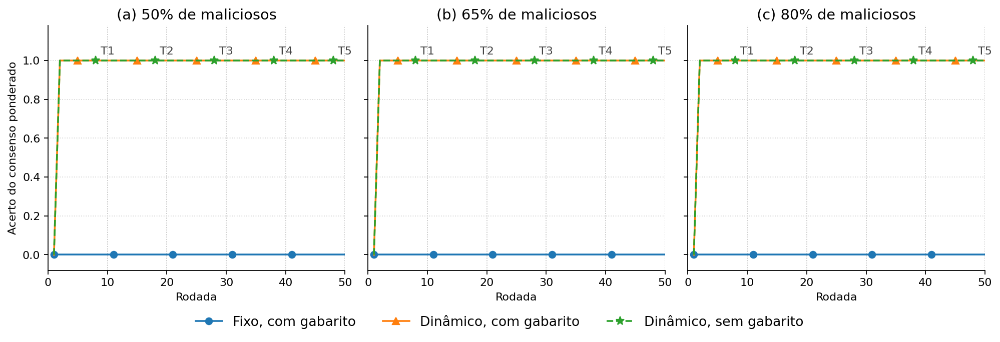
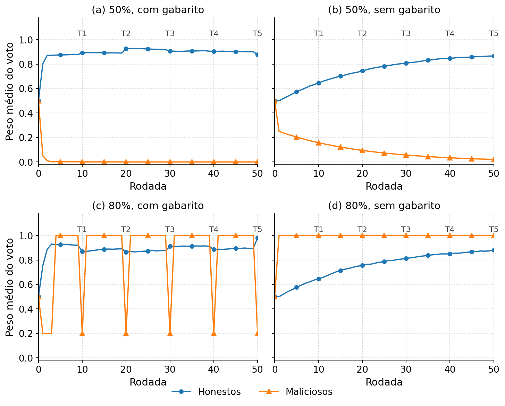

# Leitura dos gráficos do artigo

Dois gráficos entram no texto. Os dois usam 50 nós, 50 rodadas e cinco repetições. O malicioso sempre vota 999. As linhas verticais T1 a T5 são as rodadas 10, 20, 30, 40 e 50.

Três configurações aparecem no primeiro gráfico:

- Fixo, com gabarito: um líder fixo, uma cadeia só. O gabarito entra na reputação só nas rodadas T1–T5.
- Dinâmico, com gabarito: líder eleito, grafo 4-regular, defesas ligadas. O gabarito entra nas três primeiras rodadas (calibração) e de novo em T1–T5.
- Dinâmico, sem gabarito: a mesma eleição e as mesmas defesas, com zero rodadas de gabarito.

O segundo gráfico mostra só o dinâmico, e só o peso do voto.

## 1. Acerto do consenso, rodada por rodada

Arquivo: `acerto_por_rodada_50_65_80.png`

O eixo vertical é o acerto do consenso ponderado: 1 quando a resposta da cópia de referência coincide com o gabarito, 0 quando não coincide. Cada ponto é a média das cinco repetições. Nos três painéis essa média ficou em 0 ou em 1, porque as cinco repetições concordaram.

### Painel (a) — 50% de maliciosos, 25 contra 25

O fixo fica em 0 da rodada 1 à rodada 50. A validação muda a reputação, e o consenso daquela rodada continua 999.

No dinâmico, a rodada 1 erra e, da rodada 2 em diante, acerta. As duas curvas, com gabarito e sem gabarito, ficam uma sobre a outra.

Há uma cadeia só. Na rodada 1 todos começam com reputação 0,5. Os 25 maliciosos confirmam 12,5 de uma soma 25. O quórum pede estritamente mais da metade, a rodada forjada é anulada, e quem confirmou é punido. Na rodada 2 o líder é o honesto `node-25`, nas cinco repetições, com e sem gabarito.

### Painel (b) — 65% de maliciosos, 32 contra 18

O fixo continua em 0 nas 50 rodadas. Trinta e dois votos iguais vencem os 18 honestos mesmo que todos acertem.

No dinâmico, a rodada 1 erra e o restante acerta, com ou sem gabarito. O 1 não é um livro único da rede. Os 32 maliciosos confirmam 16 de 25, o quórum passa e o registro entra na cópia deles. Os 18 honestos recusam e seguem outra cópia. O acerto medido é o dessa cópia, que junta só as respostas desses 18 nós. A maioria simples, contada sobre as 50 respostas, fica em 0.

### Painel (c) — 80% de maliciosos, 40 contra 10

O mesmo desenho do painel (b). O fixo fica em 0. No dinâmico, a rodada 1 erra e, da 2 à 50, acerta, com e sem gabarito.

Os 40 maliciosos confirmam 20 de 25, o quórum passa e os 10 honestos recusam. O 1 é a cópia desses 10 nós. Os 40 votos 999 ficam na outra cópia. Nas cinco repetições houve uma divisão e duas cadeias no fim.

A configuração sem gabarito tem zero rodadas de validação e a mesma curva. O acerto, em 65% e em 80%, não vem da validação. Vem da anulação, em 50%, e da divisão da cadeia, em 65% e em 80%.

## 2. Peso do voto no dinâmico, rodada por rodada

Arquivo: `reputacao_dinamico_50_e_80.png`

O eixo vertical é o peso médio do voto de cada perfil, média das cinco repetições. Azul é o honesto. Laranja é o malicioso. O fixo não está nesta figura.

Em 50% há uma cadeia só, e as duas curvas são os dois perfis dentro dela. Em 80% a rede se divide: a curva laranja é a média na cópia dos 40 maliciosos, e a azul é a média na cópia dos 10 honestos. O painel de 65% não entra, porque as duas cópias não cabem numa média só.

### Painel (a) — 50%, com gabarito

Todos partem de 0,5. A calibração separa os perfis já na primeira rodada: o honesto fica em 0,804 e o malicioso em 0,050. No fim da terceira rodada, 0,872 e 0,002. Na rodada 50, 0,878 e 0,000. O malicioso não recupera peso.

### Painel (b) — 50%, sem gabarito

Não há calibração. A punição da rodada 1 deixa o malicioso em 0,250 e o honesto em 0,500. Daí em diante só o peso do voto se move, com passo 0,05. A subida do honesto e a descida do malicioso são lentas. Na rodada 50 as médias são 0,867 e 0,020. A reputação usada na eleição, nesse caso, permanece em 0,25.

O acerto do primeiro gráfico, neste painel, já é 1 desde a rodada 2, mesmo com o malicioso ainda acima de zero. A punição da rodada 1 já separou os pesos o bastante para o rodízio encerrar.

### Painel (c) — 80%, com gabarito

A curva laranja é um dente de serra, e esse dente é a cópia dos 40, não o peso deles dentro do consenso honesto.

Quando um líder malicioso forja o registro e o quórum passa, a cópia maliciosa grava peso 1 para o conluio. Nas rodadas com gabarito, a validação aplica sinal 0 e passo 0,8, e esse 1 cai para 0,2. A rodada seguinte sem gabarito grava 1 de novo. Por isso a laranja fica em 0,2 nas rodadas 1, 2, 3, 10, 20, 30, 40 e 50, e em 1 no intervalo. As três primeiras são a calibração. As outras cinco são T1–T5.

A curva azul é a cópia dos 10 honestos. Depois da primeira rodada a média deles é 0,756, e segue alta até o fim. O 1 do gráfico de acerto é essa cópia. A conta do passo 0,8, dentro de um livro só, não poria esses 10 à frente dos 40: o teto do conluio seria 8, contra cerca de 6,5 do lado honesto.

### Painel (d) — 80%, sem gabarito

Não há validação para puxar o 1 para baixo. Na cópia dos 40, o malicioso sobe a 1 na primeira rodada e permanece em 1 até a rodada 50. Na cópia dos 10, o honesto parte de 0,500 e chega a 0,881 na rodada 50, no mesmo passo lento do painel (b).

Mesmo com o malicioso em 1 na cópia dele, o acerto medido continua 1 a partir da rodada 2. As duas cadeias não se misturam nessa conta.
