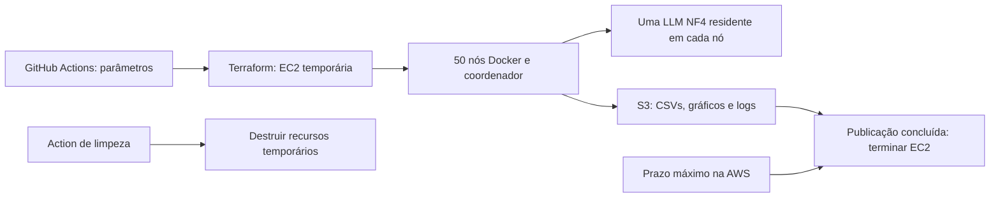

# Validação temporária na AWS

O workflow `Validation on temporary AWS GPU` cria um servidor com várias GPUs, executa os nós Docker, publica resultados no S3 e encerra a instância. **Cada nó carrega sua própria cópia NF4 do SmolLM3 dentro do contêiner e consulta essa cópia durante todas as rodadas do cenário.** O controle experimental continua sendo o orquestrador dinâmico existente.

A grade local com **Qwen3-0.6B** descrita no [README principal](../README.md) usa **cinco** instâncias compartilhadas no gateway do host, não este desenho AWS. Os resultados parciais dessa extensão estão em `resultados/llm/impacto-qwen-20261116/`; não os misture com saídas Smol deste workflow sem relabelar modelo e arquitetura.



## Cenários

| Parâmetro | Modo `matrix` | Modo `custom` |
| --- | --- | --- |
| Participantes | 50 contêineres | `honest_nodes + malicious_nodes`, entre 6 e 100 |
| Maliciosos | 10, 20, 30 e 40 (20%, 40%, 60%, 80%) | Contagem informada no formulário |
| Honestos | 40, 30, 20 e 10 | Contagem informada no formulário |
| Rodadas | 50 por configuração, ajustável entre 2 e 50 | Mesmo controle |
| Auditoria | p = 0,1 e p = 0,2 | Ambas |
| Nota do gabarito | Exata e graduada | Ambas |
| Total padrão | 16 configurações; 40.000 gerações novas | 4 configurações; total de nós × rodadas × 4 |

No modo `matrix`, as contagens do formulário são ignoradas. A semente é fixada antes da execução; o padrão é 0 e não é escolhido em função de acertos. Os primeiros cinco turnos imitam comportamento honesto; em testes com até cinco rodadas, usa-se `rodadas - 1` para permitir ao menos uma rodada de ataque. O conluio, ruído relativo 0,2, medoide, reputação `ema_slow_up`, grau 4 e conferências aleatórias seguem os testes locais. Cada nó mantém seu próprio cache SQLite, identificado por cenário, nó, revisão do modelo, rodada e tarefa. Uma repetição HTTP recupera a geração daquela rodada; uma nova configuração exige novas gerações.

Os 50 nós são serviços separados no mesmo computador, com **50 processos de inferência e 50 cópias residentes dos pesos do modelo na GPU**. Os arquivos dos pesos no disco são montados somente para leitura e podem ser comuns; os modelos carregados, as sementes e as gerações pertencem a cada nó. Não há gateway de inferência na execução AWS. O runner carrega um nó por GPU a cada lote e só inicia o orquestrador depois que todos confirmam um modelo carregado. Uma falha de carga interrompe o cenário, sem substituir a LLM por simulação.

Todos os maliciosos também consultam sua própria LLM em cada rodada. Para preservar o ataque coordenado dos testes anteriores, eles compartilham a resposta-base de um integrante e enviam a mesma resposta perturbada durante o ataque. O cache registra separadamente a geração própria e a resposta enviada. Os honestos enviam a resposta gerada pela própria cópia. O arquivo de tarefas fornece perguntas e gabaritos apenas ao coordenador; nenhuma resposta pré-gerada é usada. A execução mede distribuição lógica com comunicação HTTP dentro de um único servidor.

## Recursos e encerramento

O perfil preparado para 50 cópias residentes é `g6e.48xlarge`: oito GPUs NVIDIA L40S, cerca de 44 GiB úteis por GPU, 192 vCPUs e 1.536 GiB de RAM. São recursos de uma única máquina. Os nós são distribuídos de forma fixa, com seis ou sete modelos por GPU; cada contêiner enxerga apenas a GPU atribuída. A RAM do sistema e a VRAM são recursos distintos, e a memória de GPUs diferentes não é tratada como um bloco único. [Especificações oficiais AWS](https://docs.aws.amazon.com/ec2/latest/instancetypes/ac.html).

O planejamento reserva **4 GiB por modelo mais 6 GiB livres por GPU**. Para sete cópias, o orçamento é 34 GiB por GPU. Isso é uma condição de admissão conservadora, ainda sem medição de 50 modelos na AWS. A medição anterior de duas cópias NF4 na GPU local registrou aproximadamente 3 GiB reservados por processo; não mede o pico de 50 modelos. Os nós agora registram `model-runtime.json` com memória alocada, reservada e pico durante a execução para conferir esse dimensionamento.

| Perfil | GPUs | Máximo de nós pelo orçamento atual | Uso preparado |
| --- | ---: | ---: | --- |
| `g6e.4xlarge` | 1 | 9 | Piloto pequeno |
| `g6e.12xlarge` | 4 | 36 | Cenário personalizado menor |
| `g6e.48xlarge` | 8 | 72 | Grade de 50 nós |

O controle rejeita combinações sem orçamento antes de criar recursos pagos. O Terraform repete a verificação, e o bootstrap confere o número real de GPUs e a VRAM livre. A disponibilidade depende da região, zona e cota G/VT de vCPUs da conta; o perfil padrão exige 192 vCPUs dessa cota. O tamanho anterior de uma GPU e 64 GiB de RAM não é usado para a grade de 50 modelos residentes. O Terraform escolhe uma DLAMI Ubuntu NVIDIA pelo parâmetro público da AWS; `AWS_GPU_AMI_ID` permite fixar a imagem regional depois de um primeiro teste.

Uma VPC e uma subnet públicas temporárias permitem baixar modelo/dependências e enviar resultados. Não há portas de entrada, NAT Gateway ou Elastic IP. Os nós se comunicam na rede Docker. A instância usa IMDSv2; os contêineres não precisam de credenciais AWS. O host tem acesso apenas ao prefixo S3 da própria execução. O volume gp3 de 150 GiB é criptografado e excluído junto com o servidor. O bootstrap configura o runtime NVIDIA e verifica CUDA dentro da imagem dos nós.

O encerramento possui três caminhos complementares:

1. Ao concluir ou falhar, o worker envia dados, arquivo compactado e estado final ao S3 e chama `shutdown`. A EC2 foi configurada para **terminar**, liberando o volume e o IPv4 público.
2. Um timer local e um agendamento único do EventBridge Scheduler terminam o host no prazo máximo, mesmo se o Python travar ou o GitHub estiver indisponível. O prazo inclui instalação e download; o worker reserva tempo para salvar resultados. O limite padrão é 72 horas e pode variar de 1 a 168 horas. Atingir o limite produz resultados parciais, não uma execução concluída.
3. `Reconcile temporary AWS validation hosts` faz `terraform destroy` dos demais recursos temporários depois que os dados foram publicados, a EC2 terminou ou o prazo expirou. O workflow roda a cada 30 minutos na branch padrão e também aceita acionamento manual. Falha/cancelamento durante a criação dispara limpeza imediata dos recursos que já entraram no estado Terraform.

O job inicial é assíncrono: verde significa **infraestrutura criada**, não conclusão dos testes. O experimento pode ultrapassar o limite de seis horas de jobs hospedados no GitHub. A conclusão experimental é indicada em `status.json`, com `state: completed` e `upload_complete: true`.

O tempo e o pico de memória com 50 cópias residentes ainda precisam ser medidos na L40S. Os testes anteriores usavam duas cópias compartilhadas, portanto não validam o tempo desta arquitetura. O perfil com oito GPUs é substancialmente maior que a proposta inicial e precisa ter seu preço regional conferido antes da ativação. `max_hours` limita a duração, não é um orçamento em moeda. Depois de terminar a EC2, permanecem os custos de armazenamento/operações do S3; buckets, provider OIDC e role de implantação são permanentes para novas execuções. O bootstrap configura retenção padrão de 90 dias para resultados e 14 dias para o pacote de código de cada execução. Ajuste a retenção antes de aplicar se precisar preservará-los por mais tempo.

## Configuração inicial

É preciso uma conta AWS, acesso administrativo inicial para criar os buckets e papéis IAM e Terraform 1.11.4. O GitHub usa OIDC para receber credenciais temporárias. Não salve access keys no repositório.

Copie `bootstrap/terraform.tfvars.example` para `bootstrap/terraform.tfvars`. Informe `aws_region`, o repositório **que efetivamente executará as Actions**, a branch de trabalho e a branch padrão. Este checkout possui remotos para `allansouzaallu/TCC1` e `LaraCarvalho00/TCC1`; configure o destino correto. Se o provider OIDC do GitHub já existir na conta, informe `existing_oidc_provider_arn` para reutilizá-lo.

```powershell
aws sts get-caller-identity
terraform -chdir=infra/aws/bootstrap init
terraform -chdir=infra/aws/bootstrap plan -out=bootstrap.tfplan
terraform -chdir=infra/aws/bootstrap apply bootstrap.tfplan
terraform -chdir=infra/aws/bootstrap output
```

O estado inicial do bootstrap é local e deve ser preservado com segurança; os estados de cada execução ficam no bucket S3 criado por ele. A limpeza dos experimentos não executa `destroy` no bootstrap. Os buckets possuem proteção contra destruição acidental.

No repositório GitHub, em **Settings → Secrets and variables → Actions → Variables**, configure:

| Variável do GitHub | Output do bootstrap |
| --- | --- |
| `AWS_REGION` | `aws_region` |
| `AWS_PROJECT_NAME` | `project_name` |
| `AWS_GITHUB_ROLE_ARN` | `github_role_arn` |
| `AWS_TF_STATE_BUCKET` | `state_bucket` |
| `AWS_RESULTS_BUCKET` | `results_bucket` |
| `AWS_RUNTIME_BOUNDARY_ARN` | `runtime_permissions_boundary_arn` |
| `AWS_GPU_AMI_ID` | Opcional: AMI regional testada; deixe ausente para consulta oficial |

Publique todos os arquivos necessários deste checkout na branch que será executada, inclusive `sistema/dados/banco_smol.json` e os módulos de inferência/experimentos. O pacote é gerado a partir do commit da Action. Arquivos locais ainda sem commit não são enviados. Disponibilize também o workflow de limpeza na branch padrão: workflows agendados do GitHub só rodam nela, cujo nome também precisa estar no trust OIDC.

## Iniciar, acompanhar e interromper

Em **Actions → Validation on temporary AWS GPU → Run workflow**, selecione `matrix`, perfil `g6e.48xlarge`, 50 rodadas, semente 0 e o prazo máximo desejado. Para definir quantidades manualmente, selecione `custom` e informe honestos e maliciosos; a execução continua comparando as duas notas e os dois valores de p. O máximo depende do perfil de VRAM, conforme a tabela. Comece por um teste `custom`, 4 honestos + 4 maliciosos, perfil `g6e.4xlarge`, 2 rodadas e prazo de 2 horas para conferir carga de modelos, GPU, downloads, envio e encerramento antes da grade maior. O prazo é um limite, não uma previsão de duração.

O resumo da Action informa o identificador, por exemplo `gh-123456789-1`, e o prefixo S3:

```text
s3://BUCKET/runs/gh-123456789-1/
  input/                  # commit do código e configuração
  control/                # parâmetros Terraform, outputs e comprovante de limpeza
  status.json             # progresso e indicação de upload final
  results/                # CSVs, manifestos e gráficos
  checkpoints/            # backups SQLite consistentes durante a execução
  runtime/                # logs e versões do ambiente
  results.tar.gz          # pacote final dos resultados
```

Para ler o progresso ou baixar os resultados usando uma identidade AWS com acesso ao bucket:

```powershell
aws s3 cp s3://BUCKET/runs/RUN_ID/status.json -
aws s3 sync s3://BUCKET/runs/RUN_ID/ resultados/aws/RUN_ID/
```

Os CSVs incluem métricas por rodada, por nó e histórico de reputação, além de manifestos e logs. PNG/PDF e legendas são produzidos para a grade comparável quando os cenários necessários estão completos. O manifesto mantém explícitos cenários pendentes, falhos e interrompidos. Uma única semente permite uma validação inicial; não representa um estudo com repetição estatística.

Para interromper antecipadamente, abra **Reconcile temporary AWS validation hosts → Run workflow**, informe `run_id` e marque `terminate_now`. Isso força a destruição da execução selecionada; apenas os dados já enviados ao S3 poderão ser recuperados. Desmarcado, o workflow verifica o estado e preserva as execuções ainda ativas dentro do prazo. Cancelar o job de lançamento depois que ele ficou verde não interrompe a EC2; use o workflow de limpeza.

## Verificações locais

```powershell
terraform fmt -check -recursive infra/aws
terraform -chdir=infra/aws/bootstrap init -backend=false
terraform -chdir=infra/aws/bootstrap validate
terraform -chdir=infra/aws/bootstrap test
terraform -chdir=infra/aws/run init -backend=false
terraform -chdir=infra/aws/run validate
terraform -chdir=infra/aws/run test
.\.venv-llm\Scripts\python.exe -m unittest discover -s sistema/tests -p 'test_cloud_*.py' -v
.\.venv-llm\Scripts\python.exe -m unittest sistema.tests.test_runner_containers -v
```

O workflow `Validate cloud infrastructure` repete as verificações sem credenciais AWS. Essas verificações validam os arquivos e as decisões do ciclo de vida, mas não substituem um teste real na conta, onde cotas, IAM, disponibilidade GPU e o ambiente da AMI precisam ser confirmados.

## Referências

- [Especificações EC2 GPU](https://docs.aws.amazon.com/ec2/latest/instancetypes/ac.html).
- [DLAMI Ubuntu e parâmetro SSM oficial](https://docs.aws.amazon.com/dlami/latest/devguide/aws-deep-learning-x86-base-gpu-ami-ubuntu-22-04.html).
- [Limites do GitHub Actions](https://docs.github.com/en/actions/reference/limits).
- [Credenciais AWS por OIDC no GitHub](https://docs.github.com/en/actions/how-tos/secure-your-work/security-harden-deployments/oidc-in-aws).
- [Backend S3 e lockfile Terraform](https://developer.hashicorp.com/terraform/language/backend/s3).
- [Targets AWS SDK do Scheduler](https://docs.aws.amazon.com/scheduler/latest/UserGuide/managing-targets-universal.html).
