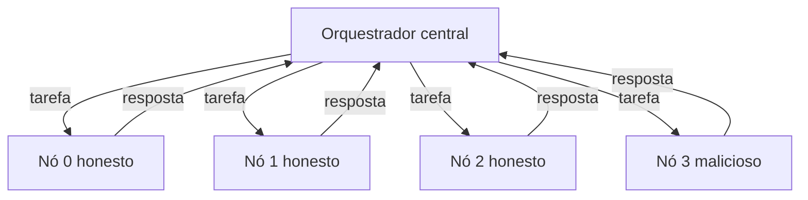
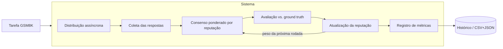

# Sistema — Rede Distribuída de Inferência com Reputação

Implementação da versão inicial do TCC: um **orquestrador central fixo** distribui
tarefas a **nós em containers**, coleta as respostas de forma **assíncrona**, aplica
**consenso ponderado por reputação**, atualiza a **reputação dinâmica** dos nós e
registra **métricas** de cada rodada.

Esta primeira versão segue as decisões da reunião de orientação (20/08): começar
simples, com orquestrador fixo em rede bem conectada, para obter rapidamente um
sistema mínimo funcional.

## Mapa das decisões → implementação

| Decisão da reunião | Onde está |
| --- | --- |
| Orquestrador fixo, rede bem conectada (estrela) | [orchestrator/run.py](sistema/orchestrator/run.py) |
| Comunicação assíncrona | `httpx` + `asyncio.gather` (orquestrador) e FastAPI (nós) |
| Nós honestos / maliciosos / instáveis | [core/behavior.py](sistema/core/behavior.py), [node/app.py](sistema/node/app.py) |
| Reputação dinâmica atualizada por rodada | [core/reputation.py](sistema/core/reputation.py) |
| Consenso (ponderado vs. maioria) | [core/consensus.py](sistema/core/consensus.py) |
| Dataset GSM8K (+ amostra offline) | [core/dataset.py](sistema/core/dataset.py) |
| Modelo pequeno (SmolLM3-3B) | [node/inference.py](sistema/node/inference.py), [scripts/test_model.py](sistema/scripts/test_model.py) |
| Ground truth só no orquestrador | tarefas em modo `real` não enviam `expected` |
| Métricas (acurácia, consenso, tempo, reputação) | [core/metrics.py](sistema/core/metrics.py) |

## Estrutura

```
sistema/
├── core/            # lógica compartilhada (sem dependências externas)
│   ├── reputation.py    # EMA da reputação
│   ├── consensus.py     # consenso ponderado e por maioria
│   ├── behavior.py      # perfis honest/malicious/unstable (simulação)
│   ├── dataset.py       # GSM8K + amostra offline
│   ├── answer.py        # extração da resposta numérica
│   ├── metrics.py       # registro CSV/JSON
│   ├── topology.py      # grafo entre os nós (completo ou k-regular)
│   ├── ledger.py        # cadeia de registros encadeados por hash
│   ├── election.py      # eleição do líder e escolha do auditor
│   ├── protocol.py      # proposta, verificação, quórum, gabarito, aplicação
│   ├── defenses.py      # medidas contra conluio (presets da ablação)
│   ├── network.py       # rede simulada com líder eleito (processo único)
│   ├── replica.py       # cópia da cadeia de um nó em container
│   └── data/gsm8k_sample.json
├── simulate.py      # simulação local (sem Docker, sem modelo)
├── node/            # servidor FastAPI do nó + inferência + protocolo dinâmico
├── orchestrator/    # orquestrador assíncrono (fixo) ou coordenador (dinâmico)
├── scripts/         # compose, matriz de experimentos, gráficos, teste de modelo
├── tests/           # testes unitários (python -m unittest discover -s sistema/tests -t .)
└── config/experiment.yaml
```

## Uso rápido

### 1) Simulação local (sem instalar nada)

Valida reputação, consenso e métricas em segundos, usando só a biblioteca padrão:

```bash
python -m sistema.simulate --nodes 4 --malicious 0.25 --rounds 20
```

Cenário difícil (50% maliciosos em conluio) — mostra a vantagem da reputação:

```bash
python -m sistema.simulate --nodes 4 --malicious 0.5 --collusion-value 999 --rounds 20
```

### 2) Rede em containers (comunicação assíncrona)

```bash
docker compose up --build
```

Sobe 4 nós (3 honestos + 1 malicioso) e o orquestrador, que roda o experimento e
grava as métricas em `sistema/results/`. Modo `mock` por padrão (sem modelo).

Escalar para mais nós (ex.: 10 nós, 25% maliciosos):

```bash
python -m sistema.scripts.gen_compose --nodes 10 --malicious 0.25
docker compose -f docker-compose.generated.yml up --build
```

### 3) Testar o modelo no GSM8K

```bash
pip install -r sistema/requirements-model.txt
python -m sistema.scripts.test_model --model HuggingFaceTB/SmolLM3-3B --dataset gsm8k --num-samples 20
```

## Mecanismo de reputação

Cada nó começa com reputação `0.5`, atualizada a cada rodada por média móvel
exponencial:

$$r \leftarrow (1 - \alpha)\,r + \alpha\,s, \quad s = \begin{cases} 1 & \text{resposta correta} \\ 0 & \text{incorreta ou ausente} \end{cases}$$

O consenso ponderado soma a reputação dos nós que apontam cada resposta e escolhe
a de maior peso; a reputação da rodada anterior é usada como peso da rodada atual.

## Rodadas de teste

A avaliação usa o mesmo calendário em todos os experimentos: **uma rodada de
teste a cada 10 rodadas** (rodadas 10, 20, 30, 40 e 50, em numeração a partir
de 1). A reputação continua sendo atualizada em todas as rodadas. O que fica
fixo é o ponto em que a acurácia é medida.

Cada teste é registrado em `rounds.csv` (`is_test=1`, coluna `test_round`) e
no `summary.json` (`test_rounds` e `consensus_accuracy_*_on_tests`). Essas
rodadas são as linhas verticais dos gráficos.

## Orquestrador dinâmico (líder eleito a cada rodada)

Com `--orchestration dynamic` não há orquestrador fixo. A cada rodada:

1. **Eleição.** Cada nó lê a própria cópia da cadeia e chega ao mesmo líder: o
   nó disponível (no máximo 1 ausência nas últimas 5 rodadas) com maior score,
   sem repetir o líder anterior. Enquanto os scores estão empatados (diferença
   entre maior e menor abaixo de 0,05) a liderança gira em ordem.
2. **Auditor.** O melhor nó disponível a pelo menos 2 saltos do líder.
3. **Difusão.** O líder manda a tarefa só aos vizinhos do grafo; cada nó
   responde e repassa (um nó de outra cópia da cadeia só repassa).
4. **Proposta.** O líder grava o consenso ponderado e o estado de reputação que
   resulta dele num registro ligado ao anterior por hash.
5. **Verificação e quórum.** Cada nó confere a própria resposta e refaz a conta.
   A rodada vale se quem confirma soma mais da metade da reputação dos
   participantes. Proposta inválida anula a rodada e pune o líder (e quem a
   confirmou); veto sem fundamento pune o auditor.
6. **Gabarito.** O sinal `hybrid` usa o consenso nas rodadas normais e o
   gabarito nas rodadas de calibração e de teste.

Ataques: `--leader-attack forge|censor` e `--auditor-attack false_reject`.
Defesas contra conluio em maioria (`--defense`, ou flags isoladas):

| Preset | O que faz |
| --- | --- |
| `calibration` | gabarito nas 3 primeiras rodadas, antes de o conluio acumular reputação |
| `oracle_bypass` | a correção pelo gabarito não passa pelo quórum |
| `split_alpha` | taxa 0,05 para o consenso e 0,8 para o gabarito |
| `split_scores` | o poder de voto só muda com o gabarito; o consenso só elege |
| `refuse_forged` | honestos recusam registro forjado aprovado e seguem a própria cópia (divisão) |
| `all`, `none`, `all_minus_<medida>` | combinações da ablação |

```bash
# Simulação
python -m sistema.simulate --nodes 20 --malicious 0.65 --collusion-value 999 --rounds 50 \
    --orchestration dynamic --signal hybrid --topology kregular --degree 4 \
    --leader-attack forge --defense all --mechanism beta

# Matriz da rodada de testes (blocos main, consensus, auditor, ablation, scale, reference)
python -m sistema.scripts.run_matrix --plan dynamic --seeds 5
python -m sistema.scripts.export_graficos_dinamico

# Containers: cada nó recebe PEERS e NEIGHBORS e fala só com os vizinhos
python -m sistema.scripts.gen_compose --nodes 10 --malicious 0.25 --orchestration dynamic \
    --topology kregular --degree 4 --leader-attack forge --defense all
docker compose -f docker-compose.generated.yml up --build
```

No modo dinâmico o orquestrador vira só o coordenador do experimento: pergunta
o eleito a um nó, chama `POST /lead`, entrega o gabarito (`POST /oracle`) e lê
`/state` e `/ledger` para as métricas. A validação em containers fica em
`scripts/validate_docker_dynamic.ps1` e a comparação com a simulação em
`scripts/compare_docker_dynamic.py`. Resultados e leitura das hipóteses:
[resultados/orquestrador_dinamico](resultados/orquestrador_dinamico/analise.md).

## Métricas geradas (`sistema/results/`)

- `per_node.csv` — resposta, acerto, latência e reputação (antes/depois) por nó e rodada.
- `rounds.csv` — consenso ponderado vs. maioria e acerto por rodada.
- `summary.json` — acurácia agregada, tempo médio e reputação final por perfil.
- `leadership.csv` (modo dinâmico) — líder, auditor, ataque, resultado, penalidades,
  saltos, gabarito e cabeça da cadeia por rodada e cópia da cadeia.
- `ledgers/<nó>.json` (containers) — a cadeia guardada por cada nó.

## Diagrama da rede



## Diagrama de avaliação



## Próximos passos

- Rodar `test_model` para medir a acurácia do SmolLM3-3B no GSM8K e o tempo por tarefa.
- Avaliar cenários (5/10/20 nós; 0/25/50% maliciosos) com `gen_compose`.
- Orquestrador dinâmico: distribuir melhor a liderança entre os honestos (hoje os dois maiores scores se revezam).
- Incluir nós instáveis (`--unstable`) e analisar o efeito da latência.
- Migrar de `mock` para `real` (inferência com LLM) quando o hardware permitir.
